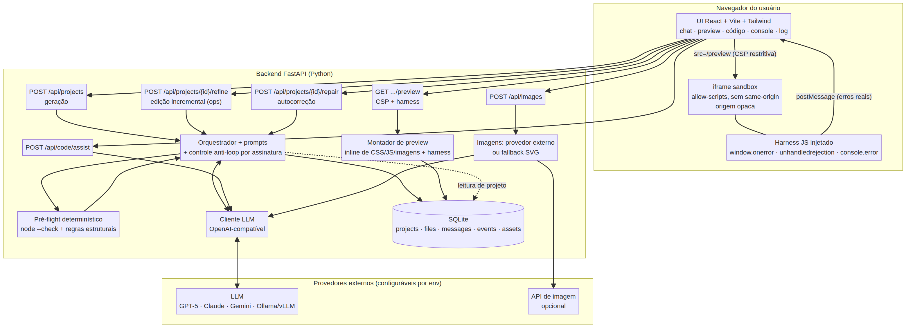

# 2. Arquitetura do brAIny

## 2.1 Visão geral

O brAIny é um monólito de dois processos: um **backend FastAPI** (Python) que
concentra todo o acesso a provedores externos e toda a validação, e um
**frontend React/Vite/Tailwind** que é compilado para estático e servido pelo
próprio backend. O artefato que o usuário gera é sempre um documento HTML
autocontido, executado num **iframe sandbox** que o brAIny observa.

```
┌──────────── Frontend (React) ────────────┐   ┌──────── Backend (FastAPI) ────────┐
│ Sidebar  │  Chat  │  Preview/Código/    │   │ /api/projects  /refine  /repair   │
│ histórico│  ajuste│  Console/Log         │◄─►│ /api/images    /code/assist       │
└──────────────────────────────────────────┘   │ Orquestrador + pré-flight + SQLite│
            ▲ postMessage (erros reais)         └────────────┬──────────────────────┘
            │                                              │
      ┌─────┴──── iframe sandbox (origem opaca) ────┐       ▼
      │ harness: onerror, unhandledrejection,       │  LLM (GPT/Claude/Gemini/Ollama)
      │ console.error → postMessage para o parent   │  Imagem (API externa ou SVG)
      └─────────────────────────────────────────────┘
```



| Diagrama | Arquivo | O que mostra |
|---|---|---|
| Componentes | `diagramas/arquitetura.png` | Blocos, dependências e fronteiras de confiança |
| Ciclo de autocorreção | `diagramas/fluxo-autocorrecao.png` | Sequência completa, camadas 1 e 2 |
| Fluxo de dados | `diagramas/fluxo-dados.png` | Do pedido ao `.zip`, incluindo os laços de correção |

## 2.2 Componentes do backend

| Módulo | Responsabilidade | Detalhe que importa |
|---|---|---|
| `app/main.py` | Rotas HTTP, CORS, montagem do frontend | O preview é servido com **CSP restritiva** e `no-store` |
| `app/config.py` | Toda a configuração por variáveis de ambiente | Nunca expõe chave ao frontend; aceita `OPENAI_API_BASE` do ambiente |
| `app/db.py` | Persistência SQLite (stdlib, sem ORM) | 5 tabelas; WAL ligado; `events` funciona como trilha de auditoria |
| `app/llm.py` | Cliente LLM OpenAI-compatível | Trata diferenças GPT (`max_completion_tokens` + `reasoning.effort`), Gemini e Claude (`max_tokens`); JSON Schema estrito; retry com backoff |
| `app/prompts.py` | System prompts e schemas | Regras técnicas do sandbox embutidas no prompt (sem `localStorage`, sem módulos relativos) |
| `app/sandbox.py` | Montagem do preview, harness e **pré-flight** | Inline de CSS/JS/imagens, injeção do harness, `node --check` por bloco de script |
| `app/generators.py` | Orquestração: gerar, refinar, corrigir | Implementa o laço de autocorreção e o **anti-loop por assinatura** |
| `app/images.py` | Geração de imagem | Provedor externo com **fallback automático** para SVG escrito pelo LLM, com sanitização |

### Modelo de dados (SQLite)

```
projects(id, name, kind, prompt, description, model, created_at, updated_at)
files(project_id, path, content, updated_at)          -- 1 projeto : N arquivos
messages(id, project_id, role, content, kind, meta)   -- histórico do chat
events(id, project_id, type, message, meta)           -- auditoria técnica
assets(id, project_id, prompt, provider, mime, file)  -- imagens geradas
```

`events.type` assume: `generate`, `refine`, `autocorrect`, `preflight_failed`,
`runtime_error`, `repair`, `image`. É essa tabela que alimenta a aba "Log
técnico" e torna o comportamento do agente auditável.

## 2.3 O ciclo de autocorreção (o diferencial, em detalhe)

### Camada 1 — servidor, determinística, antes de mostrar

1. O modelo devolve os arquivos.
2. O brAIny monta o documento final (inline de CSS/JS/imagens) e injeta o harness.
3. **Extrai cada `<script>` inline e valida com `node --check`** — erro de sintaxe
   é a causa nº 1 de tela branca, e não precisa de navegador para ser detectado.
4. Checagens estruturais baratas: `<html>`/`<body>` presentes, `<script src>`
   local não embutido, uso de `localStorage`/`sessionStorage`/`indexedDB`
   (que lança `SecurityError` em origem opaca).
5. Havendo problema, o modelo recebe os erros + o código e devolve correção;
   revalida. Para quando passa, esgota `BRAINY_MAX_REPAIR_ATTEMPTS` (padrão 3) ou
   quando a **assinatura dos erros não muda** (sem progresso → não insiste).

### Camada 2 — navegador, com erro real de runtime

1. O preview carrega em `iframe sandbox="allow-scripts ..."` (sem
   `allow-same-origin` → **origem opaca**, sem acesso ao app).
2. O harness, injetado antes de qualquer script do usuário, captura
   `window.onerror`, `unhandledrejection` e `console.error`.
3. A UI acumula os erros por ~2,5 s (evento `settled`) e, se houver, chama
   `POST /api/projects/{id}/repair` com o payload real.
4. O backend calcula a **assinatura** (hash dos erros). Se a mesma assinatura já
   gerou uma correção, ele **recusa** e explica — é isso que impede o loop
   infinito de correção.
5. O modelo corrige a causa raiz, o pré-flight roda de novo, e o preview
   recarrega com `v++`.

> Resultado prático: dos 7 cenários de teste, **o cenário 1 exigiu uma correção
> automática de sintaxe** que o usuário jamais viu — exatamente o objetivo.

## 2.4 Sandbox e segurança

| Risco | Mitigação implementada |
|---|---|
| Código gerado acessar dados do app | `iframe sandbox` sem `allow-same-origin`; origem opaca isola cookies/storage/DOM do app |
| Código gerado chamar a rede livremente | CSP no documento do preview (`default-src 'none'`, `connect-src 'none'`, `object-src 'none'`, `frame-src 'none'`, `form-action 'none'`, `base-uri 'none'`) |
| Código gerado escapar do iframe | `iframe sandbox="allow-scripts"`, sem `allow-same-origin`, formulários, popups, pointer lock ou presentation |
| SVG malicioso vindo do modelo | Sanitização: remove `<script>`, `<foreignObject>`, atributos `on*`, `javascript:` e `href` externo |
| Chave de API vazar para o navegador | Chaves só existem no `.env` do backend; o frontend nunca as recebe, nem indiretamente |
| Execução arbitrária no servidor | O servidor **não executa** o código gerado; só valida sintaxe com `node --check` (parser, sem execução) e serve texto |
| Loop de correção infinito | Assinatura de erro + limite de tentativas (servidor e cliente) |
| Injeção no preview | O documento do preview é servido com `X-Content-Type-Options: nosniff` e `Cache-Control: no-store` |

**O que esse desenho não protege:** o iframe ainda roda JavaScript de verdade no
navegador do usuário e pode consumir CPU. Imagens HTTPS são permitidas como recurso
visual estático para preservar landing pages; scripts externos ficam limitados a
jsDelivr, unpkg e cdnjs, e conexões `fetch`/WebSocket são bloqueadas. Para uso
multiusuário seria necessário um domínio separado para o preview e/ou execução em
container com `seccomp` — está no roadmap.

### Rate limiting distribuído

O backend centraliza o controle em `app/ratelimit.py` e
`app/coordination.py`. Cada chave combina usuário (quando autenticado), IP,
endpoint e operação, mas somente o hash SHA-256 é persistido. O incremento e a
expiração da janela são coordenados pelo banco compartilhado, permitindo que
várias instâncias apliquem o mesmo limite sem expor a identidade ou o IP nas
chaves armazenadas.

As operações possuem janelas independentes: leitura, chat, geração de projeto,
repair, imagem, upload e pesquisa web. Geração, imagem e repair são mais restritos
que leitura. Respostas limitadas incluem `X-RateLimit-*` e `Retry-After`; falhas
do armazenamento não expõem detalhes internos.

Em produção, o MySQL gerenciado é o armazenamento compartilhado obrigatório. Em
desenvolvimento/testes, SQLite isolado é permitido; o fallback de rate limit em
memória é somente local. A indisponibilidade do banco compartilhado falha fechada
com `503`, sem liberar tráfego caro sem controle. Redis não é uma dependência do
runtime aprovado.

### Idempotência de operações caras

`app/idempotency.py` implementa o contrato opcional `Idempotency-Key`. Ele é
aplicado a criação de projetos, refine, repair, assistência de código e geração de
imagem. Sem o header, a API mantém o comportamento anterior; com o header, a
combinação usuário + operação + chave identifica a operação.

As reservas e respostas são persistidas em MySQL compartilhado (SQLite isolado em
desenvolvimento/testes). O payload é canonicalizado e comparado por hash. A mesma chave com payload
diferente retorna `422`; duas requisições simultâneas recebem uma única execução,
enquanto a concorrente recebe `409`. Após conclusão, retries devolvem o mesmo corpo
e status com `Idempotency-Replayed: true`. O TTL padrão é de 24 horas e pode ser
ajustado com `BRAINY_IDEMPOTENCY_TTL`. Falhas liberam a chave para retry, e o lock
pendente tem expiração para não ficar preso após queda do processo. Em produção,
falhas de banco não degradam para um mapa de memória por instância.

## 2.5 Decomposição da API

| Método | Rota | Função |
|---|---|---|
| GET | `/api/health` · `/api/config` · `/api/models` | Estado, capacidades e catálogo de modelos |
| POST | `/api/projects` | Gera projeto (site/app/jogo) ou imagem (`kind=image`) |
| GET | `/api/projects` · `/api/projects/{id}` | Histórico e projeto completo |
| PATCH / DELETE | `/api/projects/{id}` | Renomear / apagar |
| POST | `/api/projects/{id}/refine` | Edição incremental por conversa (`ops`) |
| POST | `/api/projects/{id}/repair` | Autocorreção com erros reais do console |
| GET | `/api/projects/{id}/preview` | Documento único (harness + CSP) para o iframe |
| GET | `/api/projects/{id}/preflight` | Revalidação sob demanda |
| GET | `/api/projects/{id}/export` | `.zip` com o projeto + README |
| GET | `/api/projects/{id}/files/{path}` | Arquivo bruto |
| POST | `/api/code/assist` | Explicar / corrigir / refatorar / revisar código |
| POST | `/api/images` · GET `/api/assets/{id}` | Geração e entrega de imagem |

Documentação interativa automática em `/docs` (Swagger UI do FastAPI).

## 2.6 Decisões de arquitetura (e o porquê)

| Decisão | Por quê | Trade-off aceito |
|---|---|---|
| **FastAPI (Python)** em vez de Node | Mesmo processo serve o frontend estático, tem validação de schema embutida e reaproveita o ferramental de testes do Python | Não aproveita o mesmo runtime do frontend |
| **Adaptador SQLite/MySQL sem ORM** | SQLite na stdlib facilita desenvolvimento/testes locais isolados; MySQL gerenciado coordena estado e persistência compartilhados em produção | Dialetos e migrações aditivas são mantidos explicitamente; a suíte local não substitui validação operacional do MySQL gerenciado |
| **HTML autocontido como artefato** | Elimina a etapa de build para o usuário, elimina `node_modules` no resultado e torna o preview seguro e simples | Não gera aplicação multi-página com bundler; apps complexos precisam de refatoração manual |
| **Autocorreção em duas camadas** | Sintaxe é determinística (servidor resolve barato); runtime só o navegador sabe | Custo de uma chamada extra ao LLM quando há erro |
| **Harness via `postMessage`** | É o único canal confiável entre origem opaca e o app, e mantém o isolamento | Sem streaming de logs; janela de coleta de 2,5 s |
| **`node --check` para validar JS** | Validação real de sintaxe sem executar nada e sem subir navegador | Exige Node instalado no servidor |
| **Prompt com regras do sandbox** | Impede que o modelo gaste tentativas gerando código que o ambiente não suporta | Restringe o universo de saídas possíveis |
| **Refino por `ops` (find/replace)** | Mudança cirúrgica real, sem recriar o projeto; se o `find` falhar, cai para reescrita | Exige correspondência exata do trecho; 1 chamada extra no fallback |
| **Modelo de IA configurável** | Custo e privacidade sob controle do usuário (inclusive modelo local) | Qualidade varia conforme o modelo escolhido |

## 2.7 Limitações arquiteturais conhecidas

1. **Sem backend gerado** — os apps criados são client-side; persistência real
   exige serviço externo (e o código gerado não faz `fetch` para APIs sem CORS).
2. **Sem streaming** — a geração é uma requisição única; a UI mostra etapas
   estimadas, não tokens em tempo real.
3. **Fila inexistente** — geração síncrona na mesma worker do uvicorn; para
   concorrência seria preciso fila/worker dedicado.
4. **SQLite + usuário único** — sem autenticação, quotas ou isolamento por conta.
5. **Autocorreção depende do comportamento do modelo** — se o modelo repetir a
   mesma correção errada, o anti-loop interrompe e o usuário assume (por design).
