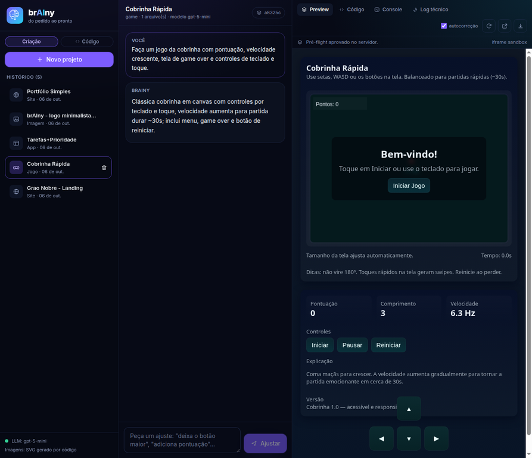
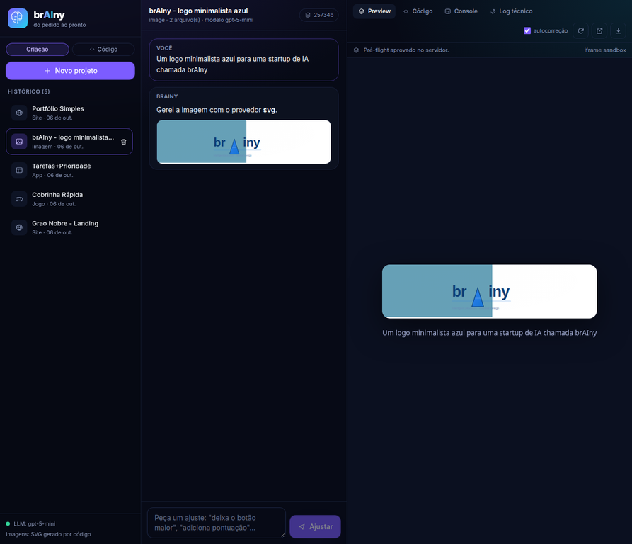

# 4. Testes — cenários reais

## 4.1 Metodologia

| Item | Valor |
|---|---|
| Data da execução | 06/10/2026, 19:29 (UTC) |
| Modelo usado | `gpt-5-mini` (o padrão do projeto — o cenário realista, não o melhor caso) |
| Backend | FastAPI + Uvicorn em `localhost:8080`, banco recém-criado (sem estado anterior) |
| Gerador de imagens | provedor padrão `svg` (o LLM escreve o SVG; sem chave extra) |
| Como reproduzir | `PYTHONPATH=backend .venv/bin/python scripts/test_scenarios.py` |
| Resultado bruto | [`testes/resultado.json`](testes/resultado.json) |

Cada cenário usa uma requisição real à API, com um pedido real em português, e
verifica propriedades objetivas do artefato (não "parece bom"): pré-flight
limpo, presença de `<canvas>` e `requestAnimationFrame`, ausência de storage
proibido, validade e sanitização do SVG, presença do bug corrigido na resposta,
e o comportamento anti-loop.

## 4.2 Resultado

> **7 de 7 cenários aprovados** (0 falhas, 0 avisos).

| # | Cenário | Resultado | Tempo | Evidência principal |
|---|---|---|---|---|
| 1 | **Site** — landing page de cafeteria | PASSOU | 45,6 s | 1 arquivo, 19.273 bytes, pré-flight limpo, formulário e `viewport` presentes |
| 2 | **Jogo** — cobrinha 2D | PASSOU | 40,7 s | 19.605 bytes, `<canvas>` + `requestAnimationFrame` + toque + pontuação |
| 3 | **App** — lista de tarefas | PASSOU | 48,5 s | 19.531 bytes, estado em memória, sem `localStorage`, com `aria`/`<label>` |
| 4 | **Imagem** — logo minimalista azul | PASSOU | 15,9 s | SVG de 3.503 bytes com `viewBox`, sem `<script>` e sem atributos `on*` |
| 5 | **Correção de bug** — off-by-one | PASSOU | 9,3 s | Encontrou `<=` → `<`, explicou `undefined`/`NaN` e devolveu código corrigido |
| 6 | **Autocorreção** (extra) — erro real de runtime | PASSOU | 79,7 s | Bug injetado detectado, causa raiz corrigida, pré-flight limpo e **anti-loop ativado** |
| 7 | **Refino incremental** (extra) | PASSOU | 10,9 s | Modo `ops` com 4 substituições cirúrgicas, 0 autocorreções, pré-flight limpo |

Tempo total de execução: **~4 min 11 s** (250,6 s), incluindo duas gerações
completas com ciclo de autocorreção.

### Evidências visuais



*Cenário 2 — jogo gerado rodando de verdade no iframe sandbox, com a barra de
status "Pré-flight aprovado no servidor", abas de Código/Console/Log técnico e o
botão de download do `.zip`.*



*Cenário 4 — imagem gerada aparece na conversa (servida por `/api/assets/{id}`) e
no preview (data URI embutido no `index.html` do projeto).*

## 4.3 Detalhe do cenário mais importante: a autocorreção (nº 6)

O teste não confia no acaso: ele **injeta um bug que o pré-flight não consegue
ver** — uma chamada `document.getElementById('elemento-que-nao-existe-9f3a').innerHTML`
dentro de um `setTimeout`. A sintaxe é válida (passa no `node --check`), mas o
código lança `TypeError` em tempo de execução — exatamente o que o harness do
iframe captura.

Depois, o teste envia à API o mesmo payload que o navegador enviaria:

```json
[{"type": "error",
  "message": "Uncaught TypeError: Cannot set properties of null (setting 'innerHTML')",
  "source": "inline", "line": 142, "col": 5}]
```

O que o brAIny fez (extraído do log de eventos do projeto):

> **Causa raiz:** havia um bloco de código que tentava acessar um elemento
> inexistente via `document.getElementById(...)` e atribuir `innerHTML`, o que
> gerou `TypeError` porque `getElementById` retornou `null`. **Correção
> aplicada:** substituí esse acesso direto por uma verificação simples — busco o
> elemento e só atribuo `innerHTML` se o elemento existir.

Verificações do teste, todas verdadeiras:

- `corrigido: true`
- `bug_removido: true` (o trecho problemático não está mais no código)
- `preflight_limpo_depois: true`
- `anti_loop_ativado: true` — a segunda tentativa com o **mesmo** erro foi
  recusada com a mensagem *"Este mesmo erro já foi tratado; a autocorreção foi
  interrompida para evitar loop."*

Este é o diferencial do produto funcionando de ponta a ponta: o brAIny não
"acha" que corrigiu — ele verifica no console e no pré-flight.

## 4.4 Bugs reais encontrados pelos próprios testes (e corrigidos)

Registro honesto do que quebrou durante o desenvolvimento. Cada correção tem
teste de regressão.

| # | Bug | Como apareceu | Correção |
|---|---|---|---|
| 1 | `re.sub` interpretava `\n` do template de substituição e **corrompia o JavaScript do harness**, fazendo o pré-flight acusar erro de sintaxe no próprio harness | Primeira execução do pré-flight: o projeto "limpo" era reprovado | `inject_harness` passou a usar função de substituição em vez de string de template |
| 2 | As checagens estruturais (`<html>`, `<body>`) rodavam sobre o documento **já montado** — que sempre é embrulhado num HTML válido. Ou seja: eram código morto, nunca detectariam nada | Teste unitário `test_preflight_detecta_falta_de_html` falhou | `preflight` passou a checar o **arquivo de entrada como o modelo o escreveu**, além das regras de sandbox sobre todo o código |
| 3 | **Falso positivo:** o modelo escreveu o comentário `// Guardado apenas em variável local (memória). Não usa localStorage.` e a checagem marcou o projeto como erro, abortando a autocorreção por "sem progresso" | Cenário 1 na primeira execução (resultado "ATENÇÃO") | Novo `strip_comments` (que respeita strings, para não quebrar `https://`) + `blank_strings`; 3 testes de regressão |
| 4 | A URL da imagem apontava para um **id diferente** do arquivo gravado em disco: `db.add_asset` gerava o próprio id, então `/api/assets/{id}` respondia **404** | Cenário 4 falhou com "Imagem não encontrada." | `add_asset` aceita `asset_id` explícito; teste de regressão garante id da tabela = nome do arquivo |
| 5 | O projeto de imagem embutia o **SVG cru** num atributo `src` (com `<`, `>`, `"` e `&`), quebrando o HTML; e o texto do usuário ia para o HTML sem escape | Revisão do fluxo de imagens antes do teste final | Data URI em base64 + `html.escape` no título, no `alt` e na legenda; 2 testes de regressão |

> Nota de método: os cenários 1, 3 e 4 só passaram depois dessas correções. A
> suíte foi reexecutada do zero, com banco limpo e o código final, e é esse
> resultado (7/7) que está reportado acima.

## 4.5 Testes unitários das partes determinísticas

```
$ cd backend && ../.venv/bin/python -m pytest tests -q
31 passed in 0.43s
```

Cobrem: montagem do preview (inline de CSS/JS/imagens, injeção do harness),
pré-flight (sintaxe, estrutura, storage, script local não embutido, comentários e
strings inofensivos), assinatura de erros (estabilidade, independência de ordem,
anti-loop), aplicação de `ops` (sucesso, trecho inexistente, ambíguo, arquivo
ausente), projeto de imagem (base64, escape, pré-flight) e persistência
(criação, atualização sem duplicar, `replace`, cascata de exclusão).

Nenhum desses testes chama LLM — são rápidos e determinísticos, e é o que
permite rodar a cada alteração.

## 4.6 Limitações observadas durante os testes

1. **Latência:** 40–80 s por geração com `gpt-5-mini` (um cenário chegou a 80 s
   por causa do ciclo de autocorreção). Sem streaming, a espera é perceptível —
   por isso a UI mostra etapas.
2. **A autocorreção consome tokens:** cada correção é uma chamada completa ao
   modelo com todo o código. Em projetos grandes isso pesa; um cache/diff
   reduziria o custo.
3. **Só o que aparece no console é corrigido.** O cenário 6 prova o mecanismo,
   mas um bug silencioso (cálculo errado sem exceção) passa. É a razão de o
   roadmap prever checagens de acessibilidade e testes de comportamento.
4. **Cenário de jogo é o mais sensível:** jogos dependem de estado e tempo; a
   verificação automatizada atual confirma a estrutura (canvas, loop, toque), mas
   não "jogou" o jogo para validar a jogabilidade.
5. **Ambiente de teste é de usuário único:** nenhum cenário exercita concorrência
   ou volume.

## 4.7 Integração local com MySQL

Os testes regulares usam SQLite em diretórios temporários exclusivos por teste;
`backend/tests/conftest.py` remove `DATABASE_URL` e `DRIZZLE_DATABASE_URL` do
ambiente injetado pelo WebDev. Assim, a suíte unitária/E2E não lê nem escreve no
MySQL gerenciado, que é compartilhado entre desenvolvimento e publicação.

Para exercitar coordenação entre instâncias sem tocar no banco gerenciado,
`docker-compose.test.yml` inicia um MySQL efêmero `brainy_test` e executa
`backend/tests/integration/test_mysql_coordination.py`:

```bash
docker compose -f docker-compose.test.yml up --build --abort-on-container-exit
docker compose -f docker-compose.test.yml down -v
```

A fixture aceita somente hosts locais (`localhost`, `127.0.0.1` ou `mysql`) e
nomes de banco terminados em `_test`, senão falha antes dos testes. A suíte prova
que duas instâncias compartilham rate limit e replay de idempotência, e que claims
de jobs são exclusivos e leases expirados podem ser recuperados. Sem
`BRAINY_TEST_MYSQL_URL`, os casos de integração são marcados como `skipped`;
isso não representa uma validação do MySQL gerenciado. Não aponte essa variável
para o banco compartilhado de desenvolvimento/publicação.
